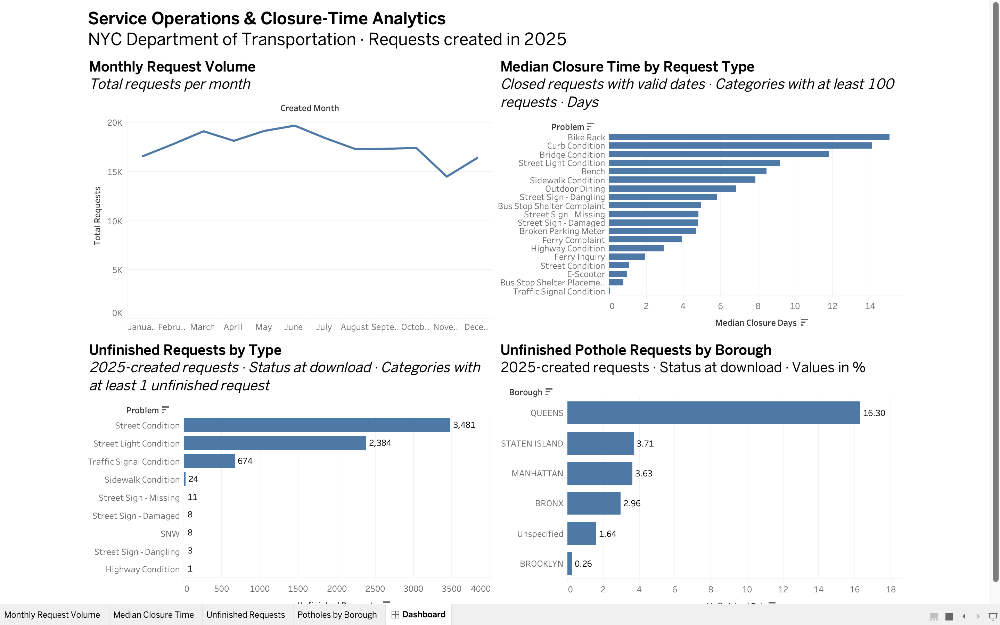

# NYC Service Operations & Performance Analytics

Analyzed 200K+ NYC transportation service requests using PostgreSQL and Tableau to explore service demand, closure times, and unfinished requests.

**Tools:** SQL, PostgreSQL, Tableau

## Analysis
- Used SQL joins, CTEs, window functions, and percentile calculations.
- Performed data-quality checks and created a reusable view for closure-time analysis.
- Built a four-chart Tableau dashboard comparing service performance across categories and boroughs.

## Key Finding
Queens had a 16.3% unfinished pothole-request rate, compared with 0.26%–3.71% across other boroughs in the analyzed dataset.

## Tableau Dashboard

